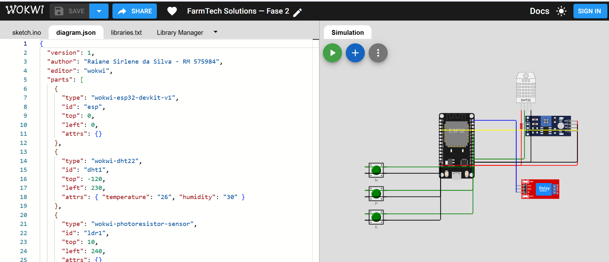

# FarmTech Solutions — Fase 2
## Sistema de Irrigação Inteligente com ESP32

Continuação do sistema de gestão agrícola iniciado na Fase 1 (cálculo de área de
plantio e manejo de insumos em Python, estatísticas e monitoramento climático em R).
Nesta fase, a fazenda ganha um dispositivo eletrônico que monitora o solo em tempo
real e decide sozinho quando acionar a bomba d'água.

**Cultura escolhida:** café (*Coffea arabica*) — a mesma da Fase 1, mantendo a
continuidade do projeto e aproveitando os parâmetros agronômicos já levantados.

---

## 1. Componentes e substituições didáticas

O Wokwi não oferece sensores agrícolas, então o projeto adota as substituições
propostas no enunciado:

| Grandeza real | Componente no Wokwi | Pino ESP32 | Tipo de leitura |
|---|---|---|---|
| Nível de Nitrogênio (N) | Botão verde | GPIO 18 | Digital — `true` / `false` |
| Nível de Fósforo (P) | Botão verde | GPIO 19 | Digital — `true` / `false` |
| Nível de Potássio (K) | Botão verde | GPIO 21 | Digital — `true` / `false` |
| pH do solo | LDR (fotorresistor) | GPIO 34 | Analógico — 0 a 4095 → escala 0 a 14 |
| Umidade do solo | DHT22 | GPIO 15 | Digital (biblioteca DHT) — % |
| Bomba d'água | Módulo relé azul | GPIO 23 | Saída digital |

Os três botões usam `INPUT_PULLUP`: o pino fica em nível alto em repouso e vai a
**LOW quando pressionado**, o que o firmware interpreta como *nutriente presente no
solo*. Isso dispensa resistores externos e deixa o circuito mais limpo.

### Conversão do LDR em pH

O ADC do ESP32 tem 12 bits, então a leitura bruta vai de 0 a 4095. A conversão é
linear sobre a escala clássica de pH:

```
pH = (leitura_analógica × 14) / 4095
```

Na prática: quanto mais luz incide no LDR, maior a leitura e mais **alcalino** fica o
solo simulado; escurecendo o sensor, o solo fica mais **ácido**. Durante a demonstração,
mexer nos botões de NPK e em seguida ajustar o LDR representa o efeito real da adubação
sobre o pH do solo.

---

## 2. Esquema de ligações


> **Substituir/complementar com o print do circuito no Wokwi** — salve a captura como
> `assets/circuito_wokwi.png` e adicione a linha abaixo:
>
> ```markdown
> 
> ```

Ligações, uma a uma:

- **DHT22** — `VCC → 3V3`, `GND → GND`, `SDA → GPIO 15`
- **LDR** — `VCC → 3V3`, `GND → GND`, `AO → GPIO 34`
- **Botões N/P/K** — um terminal em `GPIO 18 / 19 / 21`, o outro no `GND` comum
- **Relé** — `VCC → VIN (5 V)`, `GND → GND`, `IN → GPIO 23`

O arquivo [`diagram.json`](diagram.json) traz o circuito pronto: basta criar um projeto
ESP32 em [wokwi.com](https://wokwi.com), abrir a aba `diagram.json` e colar o conteúdo.

---

## 3. Lógica de decisão da irrigação

### Parâmetros agronômicos adotados (café)

| Parâmetro | Faixa | Justificativa |
|---|---|---|
| pH do solo | 5,0 a 6,8 | O cafeeiro é adaptado a solos levemente ácidos; fora dessa faixa o N, o P e o K ficam indisponíveis para as raízes |
| Umidade crítica | < 35% | Limiar de estresse hídrico — a planta começa a perder produtividade |
| Umidade preventiva | < 50% | Zona em que a irrigação ainda é vantajosa, mas não é emergência |
| Umidade máxima | ≥ 60% | Solo saturado: irrigar a mais causa encharcamento e lixiviação do adubo |

### Regras, em ordem de prioridade

| # | Condição | Bomba | Raciocínio |
|---|---|---|---|
| 1 | Falha na leitura do DHT22 | **Desliga** | Sem dado confiável de umidade, o seguro é não acionar a bomba |
| 2 | Umidade ≥ 60% | **Desliga** | Solo saturado; mais água só encharca e lava o fertilizante |
| 3 | pH < 5,0 ou pH > 6,8 | **Desliga** | Nessa condição a planta não absorve nutrientes — irrigar vira desperdício de água e de adubo |
| 4 | Umidade < 35% | **Liga** | Estresse hídrico: salvar a lavoura vem antes da eficiência da adubação, independente do NPK |
| 5 | 35% ≤ Umidade < 50% **e** N, P e K presentes | **Liga** | Fertirrigação: só vale gastar água nessa faixa quando há nutriente no solo para ser carregado até as raízes |
| 6 | 35% ≤ Umidade < 50% e NPK incompleto | **Desliga** | Aguarda a adubação antes de irrigar |
| 7 | 50% ≤ Umidade < 60% | **Mantém o estado anterior** | Histerese |

### Por que a histerese

Sem ela, uma umidade oscilando em torno de um único limiar faria o relé ligar e
desligar a cada ciclo de leitura, o que no mundo real castiga a bomba e o contator. Com
duas bordas distintas — liga em 35%/50%, desliga só em 60% — a bomba entra, completa a
irrigação e sai, sem repique.

### Fluxo do firmware

```
A cada 2 segundos (controle por millis(), sem delay() bloqueante):
  1. Lê os três botões (NPK), o LDR (pH) e o DHT22 (umidade)
  2. Aplica a árvore de decisão acima
  3. Se o estado mudou, comuta o relé e registra o evento no Serial
  4. Imprime a linha de telemetria no Monitor Serial
```

---

## 4. Saída no Monitor Serial

Velocidade: **115200 baud**.

```
================================================================
  FARMTECH SOLUTIONS - IRRIGACAO INTELIGENTE (CULTURA: CAFE)
================================================================
  pH ideal       : 5.0 a 6.8
  Umidade minima : 35% (critica) / 50% (preventiva)
  Umidade maxima : 60%
================================================================

Ciclo |   N |   P |   K |    pH | Umidade | Bomba | Motivo
------+-----+-----+-----+-------+---------+-------+--------------------
    1 |  -- |  -- |  -- |  7.82 |   30.0% |  DESL | pH fora da faixa ideal do cafe (5,0 a 6,8)
    2 |  ON |  ON |  ON |  6.10 |   30.0% |  LIGA | Umidade critica (< 35%) - irrigacao de emergencia
    3 |  ON |  ON |  ON |  6.10 |   45.0% |  LIGA | Solo seco com NPK completo - fertirrigacao liberada
    4 |  -- |  ON |  ON |  6.10 |   45.0% |  DESL | Falta nutriente (NPK incompleto) - aguardando adubacao
```

---

## 5. Estrutura do repositório

```
fase2/
├── src/
│   └── sketch.ino              # firmware do ESP32 (C/C++)
├── ir_alem/
│   └── monitor_irrigacao.py    # entrega opcional (ver seção 7)
├── assets/
│   ├── esquema_ligacoes.png    # esquema de ligações
│   └── circuito_wokwi.png      # print do circuito no Wokwi (adicionar)
├── diagram.json                # circuito pronto para o Wokwi
├── libraries.txt               # bibliotecas usadas
└── README.md
```

---

## 6. Como executar

1. Acesse [wokwi.com](https://wokwi.com) e crie um novo projeto **ESP32 → Arduino**.
2. Cole o conteúdo de `src/sketch.ino` na aba `sketch.ino`.
3. Cole o conteúdo de `diagram.json` na aba de mesmo nome.
4. Em **Library Manager**, adicione `DHT sensor library` e `Adafruit Unified Sensor`
   (ou cole o conteúdo de `libraries.txt`).
5. Clique em ▶ para iniciar a simulação e abra o Monitor Serial.

**Roteiro de demonstração:**

1. Clique no DHT22 e baixe a umidade para ~30% → a bomba só liga depois de o pH entrar na faixa.
2. Ajuste o slider do LDR até o pH ficar entre 5,0 e 6,8 → **a bomba liga** (emergência).
3. Suba a umidade para ~45% com os três botões pressionados → segue ligada (fertirrigação).
4. Solte o botão N → **a bomba desliga** (NPK incompleto).
5. Suba a umidade para 65% → a bomba permanece desligada (solo saturado).
6. Leve o LDR ao extremo (pH ~12) → a bomba desliga mesmo com o solo seco.

---

## 7. Ir Além

A pasta `ir_alem/` traz um monitor em Python que lê a porta serial do ESP32, registra o
histórico em CSV e consulta a API pública Open-Meteo: se houver previsão de chuva
relevante nas próximas horas, o script recomenda suspender a irrigação, economizando
água. Ele reaproveita a integração climática desenvolvida na Fase 1.

> Conferir contra o enunciado oficial dos opcionais 1 e 2 antes da entrega.

---

## 8. Vídeo demonstrativo

🎥 **Link do YouTube (não listado):** _adicionar aqui_

---

## 9. Autoria

Raiane Sirlene da Silva — RM 575984
FIAP — Inteligência Artificial — Fase 2
